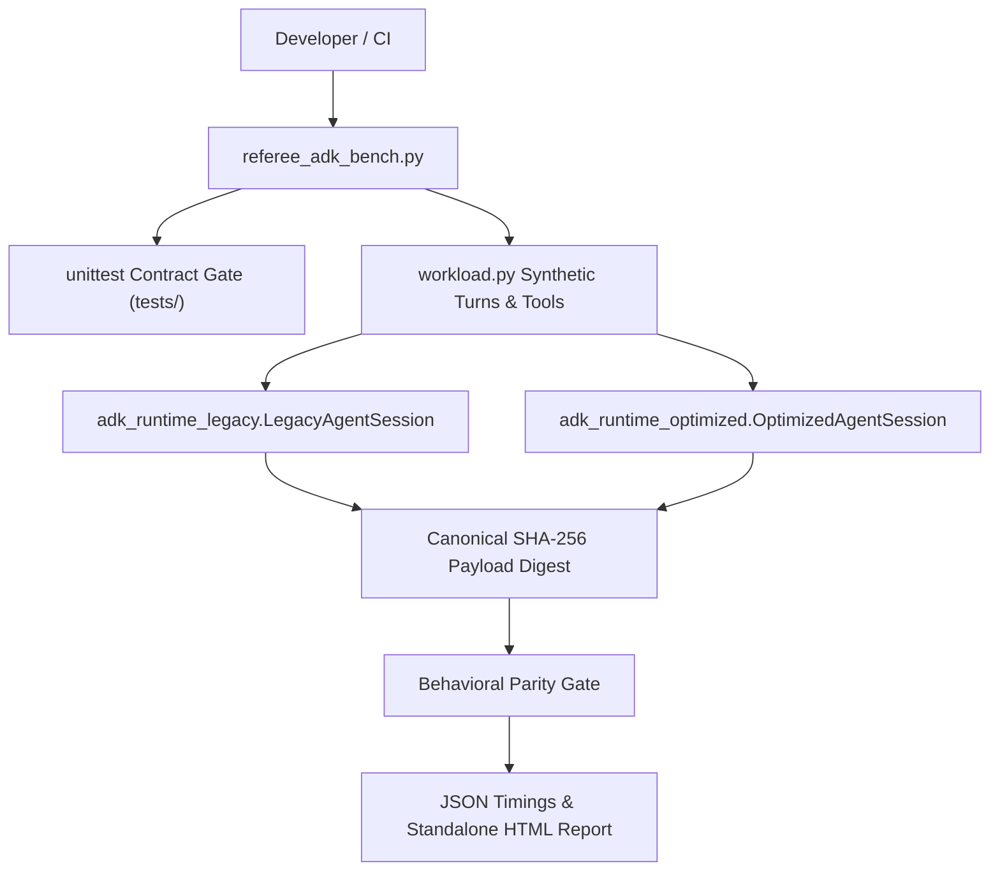
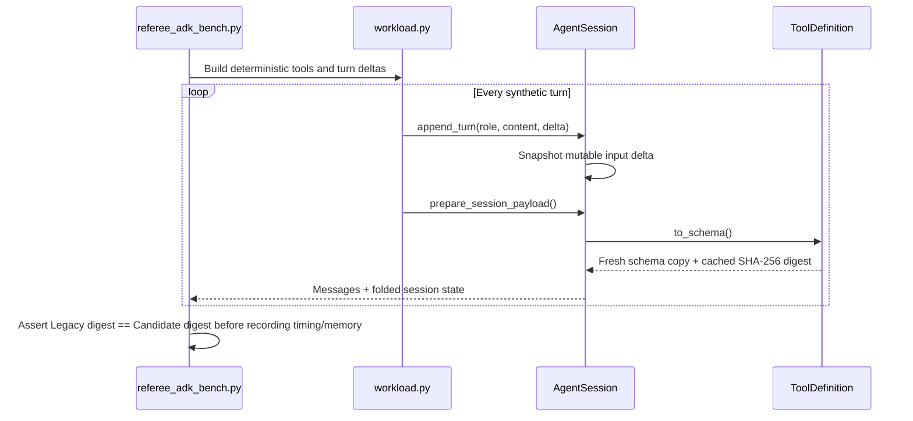

# Architecture: agent-runtime-lab

Reviewed on 2026-11-07 against the local working tree (`C:/Users/ardhy/Projects/agent-runtime-lab`). `graphify-out/graph.json` provides the local AST symbol graph.

## 1. System Context & Data Flow

Dependency-free Python runtime optimization lab comparing an eager reference agent session (`adk_runtime_legacy.py`) against a mutation-safe candidate (`adk_runtime_optimized.py`) under deterministic tool/turn workloads and behavioural digest parity gates.



## 2. Execution & Pipeline Sequence



## 3. Module Breakdown

| Path | Responsibility |
| :--- | :--- |
| `adk_runtime_legacy.py` | Reference `ToolDefinition` and `LegacyAgentSession` with eager validator registry compilation and deep-copy payload construction. |
| `adk_runtime_optimized.py` | Cycle-aware `_clone` memoization, lazy validator registry, cached tool schema digests, and mutation-safe state folding. |
| `workload.py` | Deterministic synthetic tool definitions, turn sequences, session runner, and canonical SHA-256 result digest. |
| `referee_adk_bench.py` | Contract gate runner, subprocess cold-import timer, paired session wall-time & `tracemalloc` peak-memory profiler, JSON/HTML exporter. |
| `tests/test_contract.py` | Mutation safety, shared-alias preservation, ordering, and lazy-import contract assertions. |
| `tests/test_runtime_and_bench.py` | Unit and benchmark-pipeline coverage across clone cycles, quantile summaries, and GC/tracemalloc cleanup. |
| `tests/test_measurement_pipeline.py` | Direct cycle-cloning, summary quantile invariants, and digest-gated measurement state restoration tests. |

## 4. State Management & Failure Handling

`session.events` and `session.tools` remain publicly mutable lists, so `prepare_session_payload()` folds current history rather than relying on an append-only cache. `_clone` uses an object-ID memo per call to preserve internal aliases and handle self-referential containers while isolating exported state from caller mutation. `referee_adk_bench.py` temporarily toggles `gc` and `tracemalloc` inside `try/finally` blocks.

## 5. Verification Commands

```powershell
Set-Location 'C:\Users\ardhy\Projects\agent-runtime-lab'
& 'C:\Python314\python.exe' -m pytest -q
```

## 6. Integration Boundaries

Stdlib-only offline benchmark lab; no external ADK SDK, LLM API, or database is contacted.
