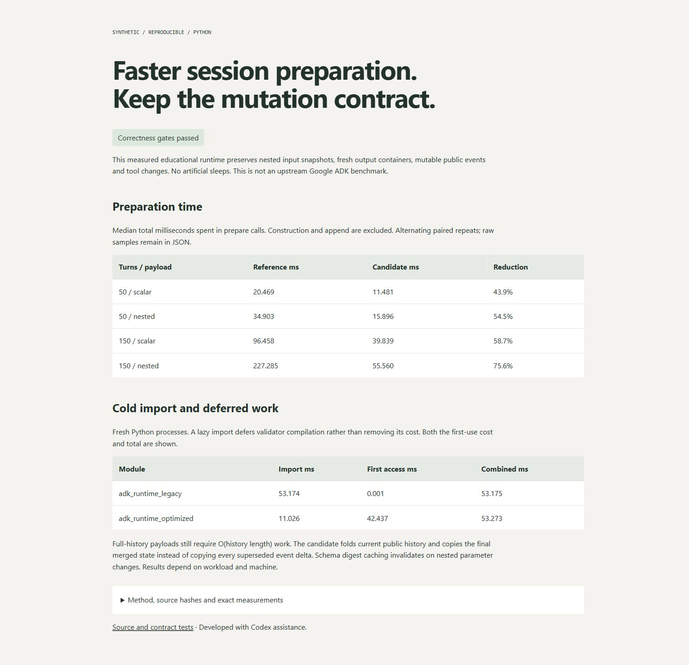

# Agent Runtime Lab

[](https://github.com/vanovri/agent-runtime-lab/actions/workflows/verify.yml)

A dependency-free Python optimization exercise with a readable reference,
mutation-safe candidate, contract tests, and correctness-gated measurements.
This is an original educational runtime inspired by the user's supplied example,
not a fork of Google ADK and not a reproduction of Google's reported benchmark.



## Run

Python 3.10+. No packages, API keys, network services, or model calls required.

```sh
python -m unittest discover -s tests -v
python referee_adk_bench.py --repeats 9 --report reports/local.json --html docs/report.html
```

Open `docs/report.html`. The JSON retains every timing sample, separately measured
peak memory, source hashes, environment, test log, and exact workload digest.
`--enforce-targets` additionally exits nonzero if median preparation savings fall
below 40% on any measured workload or fresh-process import savings fall below 20%.
CI enforces behavior and records performance separately because shared runners
are not controlled performance environments.

## What changed

- Defer compilation of 400 real regular expressions until the validator registry
  is requested. First registry access and import-plus-registry totals are both
  measured, so deferred work remains visible. There are no artificial sleeps.
- Fold current public history, then copy only the final merged state. The reference
  copied the whole event history, including obsolete deltas, then copied state again.
- Copy plain containers through a tested fast path with memoized references and a
  `copy.deepcopy` fallback for other Python types. Preserve tuples, within-schema
  aliases, across-message aliases, and independent exported state values.
- Cache only the schema digest, invalidating it when serialized parameters change.
  Return fresh parameter containers and observe current name/description/tool order.

The full transcript still requires O(history length) work. Public events remain
editable, so the candidate deliberately does not pretend an append-only incremental
cache can safely ignore external changes. The API is for trusted local use and is
not synchronized for concurrent mutation.

## Contract checks

Fourteen tests cover zero/one/50/150-turn payloads, scalar/nested state, append-input
snapshots, output mutation isolation, direct history edits/reordering/deletion,
tool edits/reordering, tuple and numeric-type preservation, alias behavior, seeded
state updates, lazy registry equality, and a fresh-process lazy-import check.

The supplied candidate is preserved in `tests/fixtures/supplied_optimized.py` as
a negative control. Mutating an input delta after append changes that candidate's
payload, violating the reference contract. The corrected implementation must not
exhibit that behavior.

## Recorded measurements

One Windows/CPython run on 19 October 2026 used nine alternating paired repeats.
Median preparation reductions were approximately 43.9%, 54.5%, 58.7%, and 75.6%
for 50/scalar, 50/nested, 150/scalar, and 150/nested workloads. Fresh-process import
time fell by approximately 79.3%. These are local workload measurements, not a
general speed guarantee. See [raw report](reports/windows.json) and
[measured report](docs/report.html).

Only `prepare_session_payload` spans contribute to the preparation-time sum;
session construction and append are outside that timer. Both variants run a warmup
before retained paired samples. Memory is measured in a separate tracemalloc run.
The lazy module moves registry cost to first use instead of eliminating that work.

## Provenance and boundaries

Adapted from a user-supplied synthetic before/after runtime. Development used Codex
assistance. The supplied 15 ms delays were removed from the benchmark reference;
the preserved negative-control fixture is never timed. The old optimization's
mutable-cache assumptions were corrected rather than advertised as safe.

No private agent chats, account data, company source, historical Google runs,
205,000-line repository, 17,000-test result, 11-hour run, or Gemini model execution
is represented by this lab. No LLM or actual ADK dependency is installed.

MIT licensed. See [the bounded prompt template](AGENT_GOAL_PROMPT.md).
